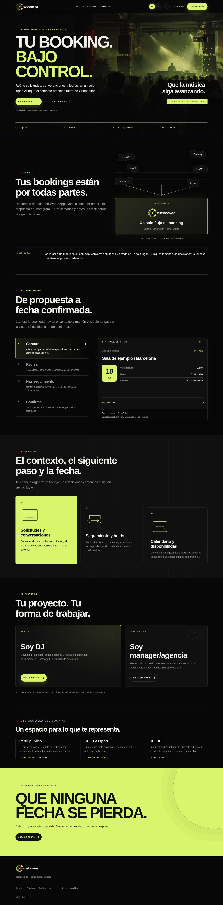
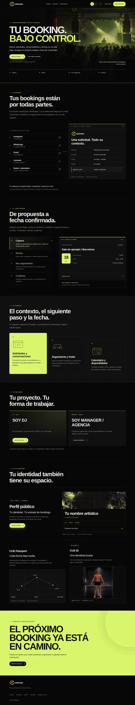

# Home 2.1 visual review

Captured in Chromium on 14 October 2026. Before: Home 2.0 at `b84d3b706190be04bf1e42ec0a43bfa3ce680709`, the version shown in the user's four reference captures. After: the compiled static Home 2.1 build. Both use Spanish, dark mode and optional analytics denied. These are full-page JPEG screenshots; click an image to inspect it at full size.

| Viewport | Before | After |
| --- | --- | --- |
| Desktop, 1440 px |  |  |
| Mobile, 390 px |  |  |

Additional browser checks covered ES/EN at 1440, 1280, 768, 390 and 320 px. The two role panels have equal dimensions and aligned headings, descriptions and CTAs. Public profile and Passport visuals are explicitly illustrative; CUE ID uses a static capture of the actual experimental laboratory model, labelled in development. No real artist history or performance metrics are displayed. No final spot asset was supplied, so no inactive video button is shown.

The signup checks reach the existing `/access?mode=signup` route and exercise the real form's required-field validation. They do not create an account or verify delivery of confirmation email. Stable staging and production were not deployed.
