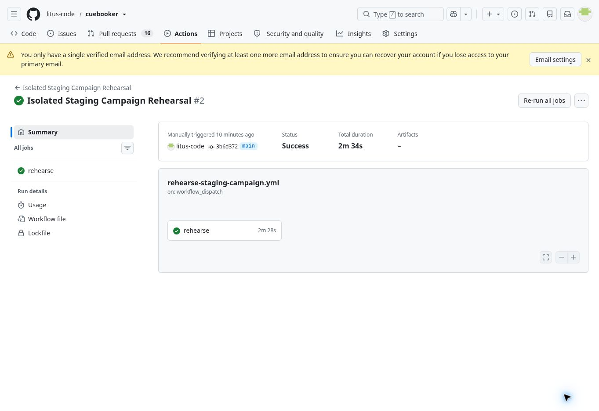

# Staging campaign analytics acceptance, 16 October 2026

Status: deployed to staging and partial hosted acceptance passed. Production promotion remains blocked by the pending items below.

## Owner browser acceptance update, 17 October

Owner confirms the Campaigns test dataset panel loads. This validates panel access, not the complete attributed signup funnel. Owner also confirms Manager restrictions (no invitations/role changes) and preserved DJ workspace. Invitation acceptance, revocation and refusal of a revoked link were checked earlier. Recovery now passes the real browser sequence: fresh email opens the form, a different password saves successfully and owner signs in with that new password. The same-password422 rejection was diagnosed from hosted Auth logs and localized feedback added in source7015aa79b5c0b19d9041a6e91dcdf5bc0224e75b (608 tests). These checks do not establish untested cross-tenant cases or production readiness.

## Hosted API funnel and cleanup, 17 October

A disposable QA visitor/account completed HTTP collector page_view/signup_click/signup_started,
actual Auth signup and password sign-in, authenticated complete_onboarding/ensure_booking_workspace,
profile publication and booking-route activation. Email confirmation was set only on the
reserved-domain QA identity through a scoped SQL fixture; this is not email-delivery acceptance.
The Core public-booking command ran under service_role SQL context, without invoking outbound
Edge email delivery. The restricted report ran under authenticated internal-admin SQL context.
It reports one visitor/account/workspace through each of six steps and five1/1 conversions.
A same-request retry reuses its booking; a second distinct enquiry still produces one activation.
These checks used actual hosted triggers, not a mocked persistence layer. No new full-browser
signup journey, Edge acknowledgement delivery or multi-account conversion test is claimed.

The QA account's actual authenticated HTTP reads return no other-workspace bookings; its campaign
report call is denied400/P0001/internal_admin_required. Consent withdrawal succeeds200 and the
session logs out204. Temporary Auth user, artist, workspace, booking, queued notifications and
campaign facts are removed. Original manually tested accounts remain. Safe aggregate evidence:
[campaign-api-qa-summary.json](campaign-api-qa-summary.json).

The two campaign FK indexes are deployed. Performance findings decrease8→6 unindexed FKs;
the six older findings remain. Source20261016220553 maps to hosted20261016220631.
Cleanup exposed the existing invalid membership-id reference in both last-owner guards.
Source20261016223115 maps to hosted20261016223158. Sixteen isolated SQL cases pass;
hosted last-owner denial and parent cascades pass for both entity types in rollback fixtures,
and actual QA cleanup succeeds. Production's same bug remains unchanged pending release.

## Exact sources and environment

- Staging: `lycprjeuuynfzwskycwv`, cuebooker-staging. Production `qlocooqfdzehogbwcbhr` was checked read-only and campaign tables remain absent.
- Owner-approved infrastructure PR117 merged at `3b6d3724f22d4209fad30b5beef6f04ad0fa1364`.
- [Corrected full current-staging rehearsal38942042150](https://github.com/litus-code/cuebooker/actions/runs/38942042150), job117111828767: SUCCESS, including cleanup. Reviewed SQL candidate `7111f156aefa09dfab8cad721422607460d9c4be`; exact SQL SHA256 `5587649f6725d3de8e50d9882f19f2980c53f00965079dd7219caeb54cdde000`.
- Pending source file `supabase/migrations/20261016120000_campaign_funnel_analytics.sql` applied through the authenticated migration connector, staging ledger name `campaign_funnel_analytics`, actual version `20261016174815`. Connector-generated ledger version differs from the source filename: reconcile this mapping explicitly before any future CLI migration operation. Never blindly db push/replay it.
- Final Edge source `af6af0ed603fa54c4b162c99b1f82eae91463d27`. Function campaign-analytics ACTIVE/version2/id e9020ab5-84d4-4425-8dcc-649655a26af0, bundle hash `1c067c0cfc46219f4c1a1b4538573b7c0febcd077476605969c83c34be747cf6`. Retrieved deployed entrypoint and both shared modules match source byte-for-byte. Bounded anonymous collector keeps verify_jwt=false per approved config; write RPCs stay service-only.
- Beta0.0.13 unchanged. [Final functional CI38943081504](https://github.com/litus-code/cuebooker/actions/runs/38943081504) and [preview38943081563](https://github.com/litus-code/cuebooker/actions/runs/38943081563) SUCCESS.599 unit tests,49 synthetic SQL assertions,44-route build. No UI changes or new visual-audit claim.

## What actually passed

The new logical snapshot was exported read-only, encrypted temporarily, restored into disconnected PostgreSQL17, checked against all COPY row counts/FK/RLS/unidentified-caller denial, then received the exact corrected SQL. Existing protected counts/domain definitions stayed unchanged; new private RLS/client denials, service RPC grants, test mode and non-admin report denial passed. No archive was uploaded or retained by this staging rehearsal.

Hosted migration preserved operational/Auth/legacy analytics counts. Four private tables have RLS and no anon/authenticated table privileges. Both public collector/withdrawal RPCs deny anon/authenticated and allow service_role. Default dataset remains test.

Actual HTTPS Edge runtime checks:
| Case | Result |
|---|---|
| CORS preflight |204, expected CORS headers |
| Unsupported method |405 |
| Malformed payload / forged signup_completed |400 |
| Payload over4096 bytes |413 |
| Valid synthetic consented page_view |200 accepted=true; SQL persisted one test event and one test visitor |
| Same event_key retry |200; SQL count remained1 |
| Consent withdrawal, final version2 |200 accepted=true, including retry |
| Event after withdrawal |200 accepted=false; SQL optional facts removed and consent/acquisition cleared |
| Direct anonymous REST collector RPC |401 /42501 |
| Direct anonymous REST report RPC |401 /42501 |
| Authenticated non-admin report and manual purge (SQL role context) |both rejected with internal_admin_required |
| Internal-admin report (SQL role context) |test dataset and6 aggregate rows; not a browser login/panel proof |

Version1 surfaced a real protocol issue: PostgREST void withdrawal returns204, while the adapter unconditionally parsed JSON. Deletion committed but the collector returned503. A regression reproduces503 on the old adapter; version2 handles204 and the complete accept/retry/withdraw/retry-denial cycle passes hosted. No raw RPC/provider errors reach the client.

Retention daily job10, `cuebooker-prune-campaign-analytics`, active at `17 3 * * *` UTC, postgres database/role. Temporary QA scheduler job11 executed the same purge helper successfully at17:50,17:51 and17:52UTC. A controlled synthetic visitor was aged91 days and its event was removed, consent revoked and acquisition cleared by the scheduler. QA job11 was unscheduled afterward. The first natural daily job10 execution is still in the future; do not describe it as already run.

Final cleanup: zero campaign events, zero consented/acquisition-bearing QA visitors,3 original legacy events,15 bookings,27 email messages and6 Auth users unchanged. Only non-consented minimal visitor tombstones remain by contract. No real user/signup/invitation/enquiry/email was created or sent.

## Advisor review and remaining work

No ERROR-level security/performance advisories appeared. Counts are per finding, not grouped categories.

| Finding | Before → after | Assessment |
|---|---|---|
| Private RLS without client policies |17 →21 INFO |four new private deny-by-default tables are intentional; client grants absent |
| Authenticated SECURITY DEFINER |5 →7 WARN |new report/manual purge explicitly enforce internal admin; actual negative checks passed |
| Unindexed FK |6 →8 INFO |new visitor_id and workspace_id FK coverage remains a performance follow-up before release |
| Leaked password protection |1 →1 WARN |pre-existing Auth setting, unchanged |
| Auth RLS initplan |3 →2 WARN |existing direct event-insert policy removed as designed |
| Multiple permissive policies |11 →11 WARN |unchanged |
| Unused indexes |38 →40 INFO |informational after new index creation; no indexes removed |

Remediation references: [FK indexes](https://supabase.com/docs/guides/database/database-linter?lint=0001_unindexed_foreign_keys), [privileged RPC review](https://supabase.com/docs/guides/database/database-linter?lint=0029_authenticated_security_definer_function_executable), [private RLS policies](https://supabase.com/docs/guides/database/database-linter?lint=0008_rls_enabled_no_policy), [existing leaked-password setting](https://supabase.com/docs/guides/auth/password-security#password-strength-and-leaked-password-protection).

Still pending: any separately required full-browser signup/multi-account conversion checks and remaining cross-tenant write cases, production-specific schema/function/Edge configuration reconciliation and isolated production delta rehearsal. Existing accepted Gmail/attachments/DJ/ESEN/mobile checks stay accepted. Live collection activation is a separate decision. PR114 remains draft/unmerged and production application/backend untouched.

Rollback remains non-destructive: pause collector/retention and optional observers, preserve schema for inspection, revert optional frontend if needed. No automatic production action follows this staging result.

